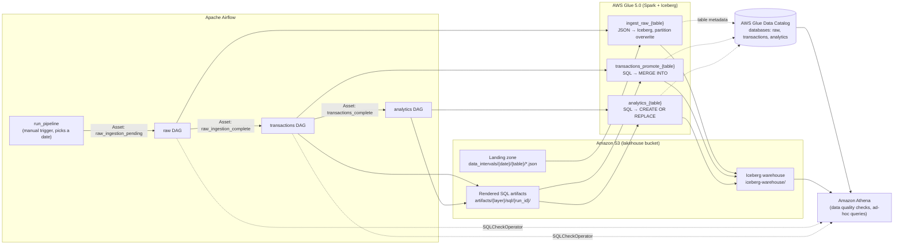

# Sparkify AWS Lakehouse Pipeline

An Airflow-orchestrated data lakehouse on AWS. It ingests raw JSON event and song data from S3 into Apache Iceberg tables, then refines it through three layers (**raw → transactions → analytics**) using AWS Glue (Spark), with data quality checks run through Amazon Athena at each stage.

<!-- TODO: add screenshot of a successful Airflow DAG run (graph view) -->

## Summary

Sparkify is a fictional music streaming service. Its app writes user activity logs (every page view, song play, upgrade, and downgrade) and it keeps a catalog of songs and artists. Both arrive in S3 as JSON files, one folder per day. The business wants to know how people listen and who converts to paid: which songs and artists get played, how long sessions last, how much each user listens, and which free users upgrade. I built the pipeline that answers those questions. Each daily batch lands in an Iceberg `raw` layer and is cleaned, deduplicated, and merged into a normalized `transactions` layer. From there it is rebuilt into four analytics tables (`user_facts`, `song_facts`, `artist_facts`, `session_facts`) that can be queried directly in Athena. Airflow chains the three stages with data-aware scheduling, so triggering one day's batch runs the whole pipeline end to end.

## Architecture



The AWS resources (S3 bucket, Glue IAM role, Glue databases, Lake Formation permissions, and an Athena workgroup) are defined in `lakehouse_infrastructure.yml`, a CloudFormation template provided with the course.

### How the DAGs chain together

1. **`run_pipeline`**: triggered manually with a `data_interval` parameter (one of the dates in the dataset). It emits an Airflow **Asset** event that carries that date in its metadata.
2. **`raw`**: scheduled on that Asset. It ingests every table folder found for the date, validates the result, then emits `raw_ingestion_complete`.
3. **`transactions`**: scheduled on `raw_ingestion_complete`. It promotes six normalized tables in dependency order, validates them, then emits `transactions_complete`.
4. **`analytics`**: scheduled on `transactions_complete`. It rebuilds the four analytics tables.

The date flows from DAG to DAG through the Asset event metadata, so every layer processes the same batch without any hardcoded dates.

## Layers

### 1. Raw layer (`raw/`)

**What it does:** lands each source as-is in an Iceberg table, adding a `data_interval` column.

- `capture_landing_keys` lists the table folders under `data_intervals/<date>/` in S3. Nothing about which tables exist is hardcoded. Any folder found becomes a table.
- `ingest` is a **dynamically mapped** `GlueJobOperator`, with one Glue job per discovered folder. The Glue script reads the JSON with Spark and writes it to `iceberg.raw.<table>`:
  - On the first run it creates the table **partitioned by `data_interval`**, stored as Parquet with Snappy compression.
  - On later runs it calls `overwritePartitions()`, which replaces only that date's partition. Re-running a day is idempotent and never touches other days.
  - Empty input folders are skipped cleanly.
- The Iceberg catalog is configured on the Glue job to use the **Glue Data Catalog** as its metastore, so the tables are immediately queryable in Athena.

**Data quality check (`validate_raw` task group):** a `SQLCheckOperator` mapped over the same discovered tables runs `SELECT COUNT(*) FROM raw.<table> WHERE data_interval = '<date>'` in Athena. It fails the run if the partition for that day is empty.

Tables produced in practice: `raw.logs` (app activity events) and `raw.songs` (song and artist catalog). These are the two tables the downstream SQL reads.

### 2. Transactions layer (`transactions/`)

**What it does:** turns raw records into clean, deduplicated, normalized tables and merges each day's batch into them.

| Table | Grain / key | Key transformations |
|---|---|---|
| `users` | `user_id` | Latest name, gender, and location from the user's most recent logged-in event; `last_seen_at` |
| `artists` | `artist_id` | One row per artist, preferring the record with non-empty location and coordinates |
| `songs` | `song_id` | One row per song; `year = 0` normalized to `NULL` |
| `song_versions` | `version_id` | One row per (song, duration); deterministic SHA-256 key so the same version gets the same ID every run |
| `user_levels` | (`user_id`, `changed_at`) | Free/paid history from `Submit Upgrade` / `Submit Downgrade` events, plus an initial "seed" level per user |
| `events` | `event_id` | Song plays only (`page = 'NextSong'`); deterministic SHA-256 `event_id` from user, session, and item; resolves each play to a `song_version` by title and duration (±0.01s tolerance); **partitioned by `event_date`** |

How each table is built:

1. An `upload` task renders the table's SQL template (injecting the batch date from the `metadata` task via XCom) and writes it to S3 under the DAG run's ID.
2. A `GlueJobOperator` runs the shared Glue script with a JSON config (table name, SQL path, upsert keys, partition keys). The script:
   - runs the SQL with Spark and drops duplicate rows on the upsert keys,
   - **creates** the Iceberg table (with partitioning if configured) when it doesn't exist yet,
   - otherwise adds any **new columns** to the target table (simple schema evolution), then runs an Iceberg **`MERGE INTO`**: update when the key matches, insert when it doesn't.
3. Tables are promoted in **dependency order**, declared in a single `TABLES` config list (`songs` waits on `artists`, `events` waits on `users`, `songs`, `artists`, and `song_versions`, and so on). Concurrency is capped at two tasks at a time.

**Data quality checks (`validate_transactions` task group), run in Athena:**

- **Primary key uniqueness** for every table: `COUNT(*) = COUNT(DISTINCT <upsert keys>)`. This catches a merge that introduced duplicates.
- **Song-version match rate** on `events`: fails if 30% or more of play events have no resolved `version_id`. This catches a broken join between the logs and the song catalog, which would otherwise quietly leave plays unmatched.

### 3. Analytics layer (`analytics/`)

**What it does:** builds business-facing aggregate tables from the transactions layer. Each table is fully rebuilt on every run (`CREATE OR REPLACE`) with one Glue job per SQL file. The DAG discovers the tables from the files in `analytics/sql/`.

| Table | One row per | Example metrics |
|---|---|---|
| `user_facts` | user | total plays, sessions, listening seconds, distinct songs and artists, current level, `is_converted` (ever upgraded to paid) |
| `song_facts` | song | total plays, distinct listeners and sessions, versions played, first and last play, share of plays from paid users |
| `artist_facts` | artist | total plays, distinct listeners, songs, and sessions, first and last play, paid play share |
| `session_facts` | session | start and end time, duration, play count, distinct songs and artists, listening seconds, level and location at session start |

Catalog songs and artists with zero plays are kept (LEFT JOIN from the dimension), so "never played" is visible rather than missing.

<!-- TODO: add a screenshot of an Athena query against analytics.user_facts or song_facts -->

## Tech stack

- **Orchestration:** Apache Airflow 3 (`airflow.sdk`): Assets / data-aware scheduling, TaskFlow API, dynamic task mapping, task groups
- **Processing:** AWS Glue 5.0 (PySpark)
- **Table format:** Apache Iceberg on Amazon S3 (Parquet + Snappy)
- **Catalog and governance:** AWS Glue Data Catalog, AWS Lake Formation permissions
- **Query and validation:** Amazon Athena via Airflow's `SQLCheckOperator`
- **Infrastructure as code:** AWS CloudFormation
- **Languages:** Python, Spark SQL, Athena SQL

## Repository structure

```
.
├── setup/
│   ├── setup_s3_data.py          # DAG: copies the course dataset into your bucket (one-time)
│   └── run_pipeline.py           # DAG: manual entry point; picks a data_interval and starts the chain
├── raw/
│   ├── dag.py                    # Raw ingestion DAG (dynamic mapping over landing folders)
│   └── glue_script.py            # JSON → Iceberg, partition-overwrite by data_interval
├── transactions/
│   ├── dag.py                    # Transactions DAG (dependency-ordered promotion + checks)
│   ├── glue_script.py            # SQL → dedupe → Iceberg MERGE INTO (with schema evolution)
│   └── sql/                      # users, artists, songs, song_versions, user_levels, events
├── analytics/
│   ├── dag.py                    # Analytics DAG (one rebuild job per SQL file)
│   ├── glue_script.py            # SQL → Iceberg CREATE OR REPLACE
│   └── sql/                      # user_facts, song_facts, artist_facts, session_facts
├── lakehouse_infrastructure.yml  # CloudFormation: S3, IAM, Glue DBs, Lake Formation, Athena
└── LICENSE.txt
```

## Key design decisions

- **Apache Iceberg instead of plain Parquet folders.** Iceberg gives ACID writes, `MERGE INTO` upserts, partition overwrites, and schema evolution on S3, with tables registered in the Glue Data Catalog so Athena can query them right away. The upsert-based transactions layer needs those features.
- **A different write strategy per layer:**
  - *Raw:* partition overwrite by `data_interval`, so re-running a day replaces exactly that day.
  - *Transactions:* merge (upsert) on business keys, so tables accumulate history across days without duplicates.
  - *Analytics:* full rebuild, since the aggregates are cheap to recompute and a rebuild can't drift out of sync with the source.
  All three are safe to re-run for the same date.
- **Deterministic keys.** `event_id` and `version_id` are SHA-256 hashes of natural attributes, so reprocessing the same data produces the same keys and merges stay idempotent.
- **Data-aware scheduling with Assets.** Each layer triggers the next by emitting an Asset event that carries the batch date. There are no cron schedules or sensors to keep aligned, and the date only has to be chosen once.
- **Config-driven, dynamic DAGs.** Raw ingestion and its checks are mapped over whatever tables exist in the landing folder. Transactions tables are declared once in a `TABLES` list (keys, partitions, dependencies), and the DAG wires the upload → promote → validate graph from it. Adding a table means adding a SQL file and a config entry, not new task code.
- **Rendered SQL stored per run.** Each run's SQL is rendered by Airflow and written to `artifacts/<layer>/sql/<run_id>/` before Glue runs it, which leaves an auditable record of exactly what query ran for each batch. (I added a missing trailing slash in the starter's S3 path constants so each run's files land in their own folder.)
- **Quality gates between layers.** The next layer is only triggered after validation passes, so bad data stops at the layer where it appeared instead of flowing into the analytics tables.
- **Concurrency limits.** `max_active_runs=1` and `max_active_tasks=2` keep runs from overlapping on the same Iceberg tables and limit how many Glue jobs run at once.

## How to run

This project runs on AWS and was built and run in Udacity's provided workspace. It isn't a one-command local setup. To reproduce it you need:

1. **AWS resources:** deploy `lakehouse_infrastructure.yml` with CloudFormation (parameters: a VPC and subnet). It creates the lakehouse S3 bucket, the `dev-lakehouse-glue-role` IAM role used by the Glue jobs, the `raw` / `transactions` / `analytics` Glue databases, Lake Formation permissions, and an Athena workgroup. *Note: the template grants Lake Formation admin to a course-specific `voclabs` role, which you would change for your own account.*
2. **Airflow 3** with the Amazon and Common SQL providers, with this repo as the DAGs folder, plus:
   - Connection **`aws_default`**: AWS credentials allowed to use S3 and Glue and to pass the Glue role
   - Connection **`athena_default`**: an Athena connection for the data quality checks
   - Variable **`s3_bucket`**: the bucket name output by the CloudFormation stack
3. **Data:** trigger `setup_s3_data` once to copy the course dataset into your bucket.
4. **Run:** trigger `run_pipeline` and choose a `data_interval` (`2026-01-01`, `2026-01-02`, or `2026-01-03`). The `raw`, `transactions`, and `analytics` DAGs then run in sequence on their own.

No credentials are stored in this repository. All AWS access goes through Airflow connections, and the bucket name comes from an Airflow variable. The region is set to `us-east-1` in the DAGs.

<!-- TODO: add screenshot of the Airflow DAG list / Assets view showing the four DAGs -->

## What I'd improve next

- **Move the SQL models to dbt** (e.g. dbt-athena or dbt-glue) to get lineage, documentation, and reusable tests (`unique`, `not_null`, `relationships`) instead of hand-written check queries.
- **CI:** a GitHub Actions workflow that parses the DAGs (import and cycle checks), lints with Ruff, and unit-tests the Glue logic with local PySpark on small fixture files.
- **More data quality coverage:** not-null and accepted-value checks (e.g. `level` in `free`/`paid`), row-count reconciliation between layers, and checks on the analytics tables, which currently have none.
- **Incremental analytics:** switch the full rebuilds to incremental merges once data volume makes a rebuild expensive.
- **Iceberg table maintenance:** scheduled snapshot expiry and small-file compaction (`rewrite_data_files`) so storage and query performance stay healthy as batches accumulate.
- **Cost and run monitoring:** track Glue DPU-hours and Athena bytes scanned per run, and add alerting on failures or SLA misses.
- **Parameterize environments:** move the region, IAM role name, and catalog settings into Airflow variables or config so the same code can deploy to dev and prod.

## Acknowledgments and license

This project was completed as part of Udacity's **Data Engineering with AWS** Nanodegree. Udacity provided the starter code: the overall DAG and Glue script scaffolding, the SQL models in `transactions/sql/` and `analytics/sql/`, the setup DAGs, the CloudFormation template, and the Sparkify dataset.

**My contribution** is the implementation in these files: `raw/dag.py`, `raw/glue_script.py`, `transactions/dag.py`, `transactions/glue_script.py`, `analytics/dag.py`, `analytics/glue_script.py`, and `setup/run_pipeline.py`. That covers the Airflow DAG definitions and Asset wiring, dynamic task mapping, Glue job configuration, the Iceberg create / partition-overwrite / merge / replace logic, and the data quality checks. The commit history keeps Udacity's starter commits separate from my implementation commit, so you can see exactly what I wrote.

Udacity's educational content is licensed under the Creative Commons Attribution-NonCommercial-NoDerivs license. See [LICENSE.txt](LICENSE.txt). This repository is shared for non-commercial, portfolio purposes.

---

**Chris Vancura** · [GitHub](https://github.com/GoldenVLabs) <!-- TODO: add LinkedIn URL -->
